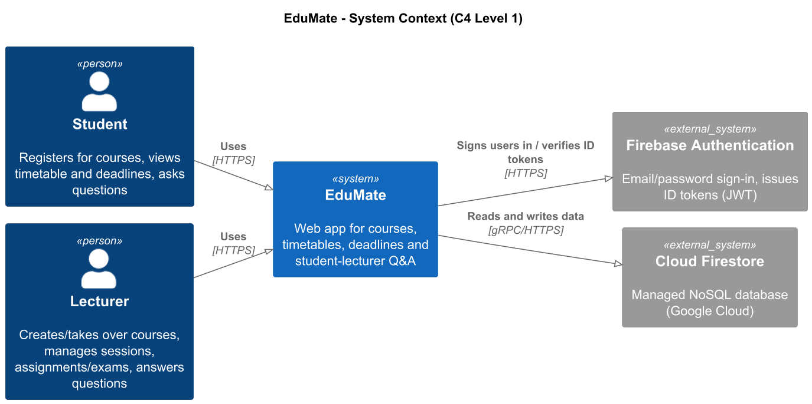
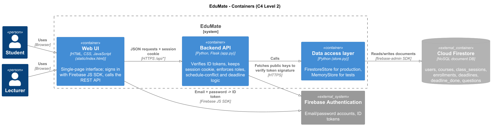
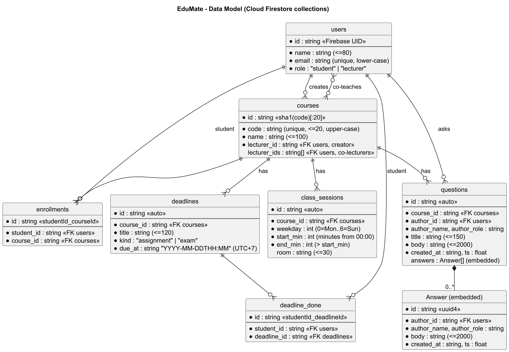
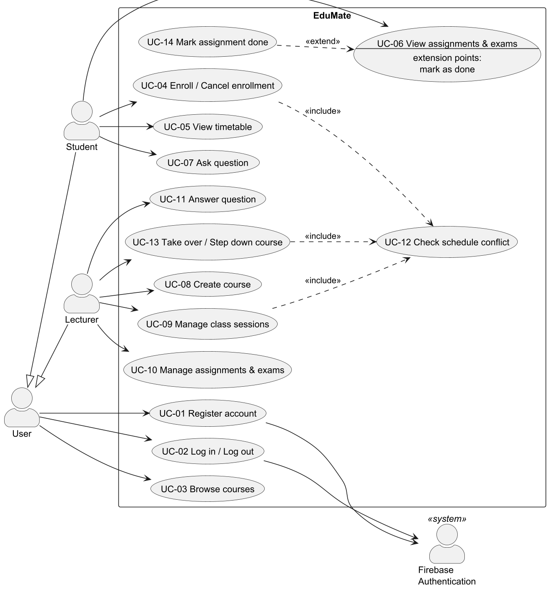
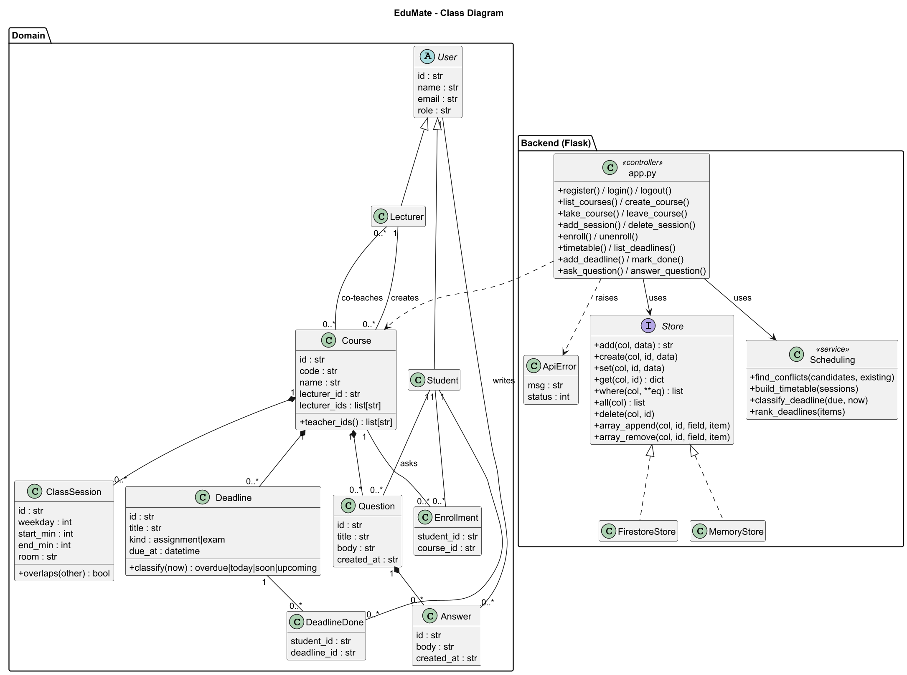
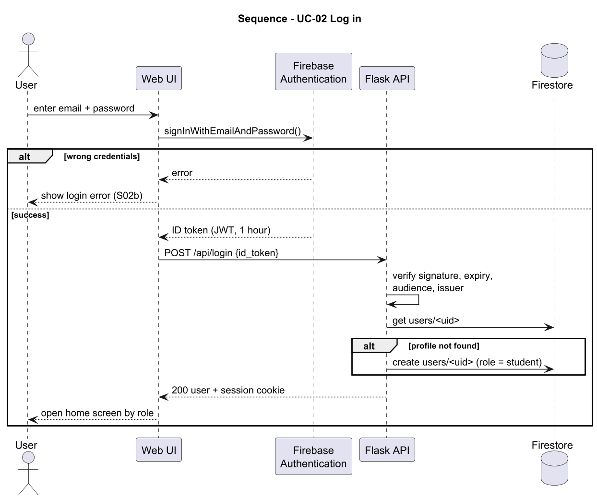
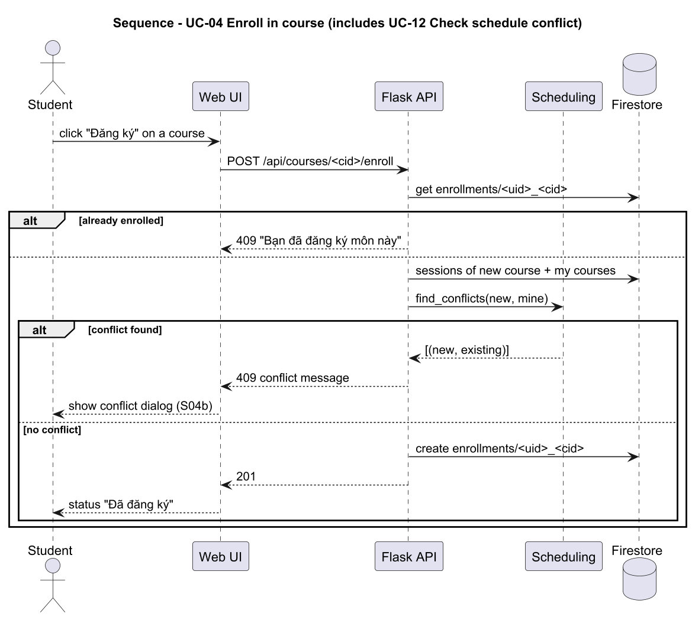
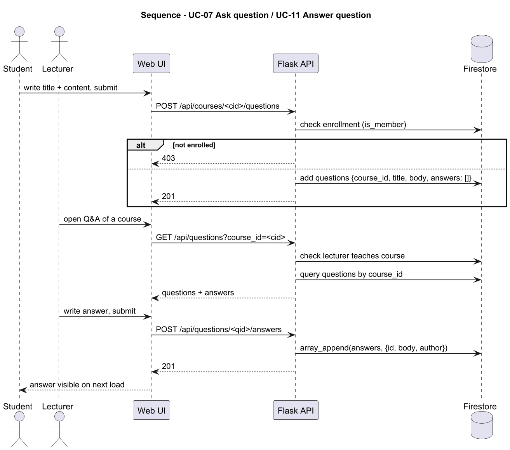

# EduMate – Design (WBS 3.1, 3.2)

Owner: 24127055 – Nguyễn Hoàng Bảo Khánh (Designer)

| WBS | Deliverable | Section |
|---|---|---|
| 3.1.1 | C4 and architecture views | [Architecture](#311-architecture-c4) |
| 3.1.2 | Data model and access rules | [Data model](#312-data-model-and-access-rules) |
| 3.2.1 | UML diagrams | [UML](#321-uml-diagrams) |
| 3.2.2 | UI wireframes / prototype | [UI prototype](#322-ui-prototype) |

---

## 3.1.1 Architecture (C4)

**Stack:** HTML/CSS/JavaScript (single page) · Python Flask · Firebase Authentication · Cloud Firestore.

### Level 1 – System Context

### Level 2 – Containers

| Container | Technology | Responsibility |
|---|---|---|
| Web UI | `src/static/index.html` | Screens for both roles; signs in with Firebase JS SDK and calls `/api/*` |
| Backend API | `src/app.py` (Flask) | Verifies Firebase ID tokens, keeps the session cookie, checks roles and course membership, runs the scheduling/deadline logic |
| Data access layer | `src/store.py` | `FirestoreStore` in production, `MemoryStore` for tests; the API never talks to Firestore directly |
| Firebase Authentication | External | Stores email/password accounts and issues ID tokens; passwords never reach the backend |
| Cloud Firestore | External | Stores all application data |

**Key decisions**
- Passwords only travel between the browser and Firebase. The backend receives an ID token, verifies signature, expiry, audience and issuer, then issues its own session cookie.
- Timetables and deadline status are recalculated from the database on every request, so a change by a lecturer is visible to students immediately.
- The storage layer is swappable (`EDUMATE_STORE=firestore|memory`), so tests run without Firebase.

---

## 3.1.2 Data model and access rules

**Notes**
- Firestore is a document database: relationships are stored as ID fields (`course_id`, `student_id`, …), not foreign keys.
- Deterministic document IDs prevent duplicates with an atomic `create()`:
  `courses/<sha1(code)>` (unique course code), `enrollments/<studentId>_<courseId>`, `deadline_done/<studentId>_<deadlineId>`.
- Answers are embedded in their question (`questions.answers[]`), because they are always read together.
- Times: `class_sessions` store minutes from midnight (`start_min`, `end_min`); `due_at` is `YYYY-MM-DDTHH:MM` in Vietnam time (UTC+7).
- A course is taught by its creator (`lecturer_id`) plus co-lecturers who took it over (`lecturer_ids`).

### Access rules

"Teaching lecturer" = creator or co-lecturer of that course. "Enrolled student" = has an `enrollments` document for that course.

| Action | Student | Lecturer | Extra rule |
|---|---|---|---|
| Register / log in / log out | ✓ | ✓ | Valid Firebase ID token required |
| View course list | ✓ | ✓ | Logged in |
| Create course | – | ✓ | Course code must be unique |
| Take over / step down from course | – | ✓ | No teaching-time conflict; the creator cannot step down |
| Add / delete class session | – | Teaching lecturer | New session must not overlap the lecturer's other sessions |
| Enroll / cancel enrollment | ✓ | – | No overlap with the student's timetable |
| View timetable, deadlines | Own courses | Courses taught | – |
| Add / delete assignment or exam | – | Teaching lecturer | Deleting also removes students' "done" marks |
| Mark deadline as done | Enrolled student | – | – |
| View questions of a course | Enrolled student | Teaching lecturer | – |
| Ask question | Enrolled student | – | – |
| Answer question | Enrolled student | Teaching lecturer | – |

Unauthenticated requests get `401`; wrong role or not a member gets `403`; conflicts and duplicates get `409`.

---

## 3.2.1 UML diagrams

### Use case diagram

- Student and Lecturer inherit the common use cases of User (register, log in, browse courses).
- UC-04 Enroll, UC-09 Manage class sessions and UC-13 Take over course all `<<include>>` UC-12 Check schedule conflict.
- UC-14 Mark assignment done `<<extend>>` UC-06 View assignments & exams.

### Class diagram

### Sequence diagrams

**UC-02 Log in**

**UC-04 Enroll in course (with UC-12 schedule conflict check)**

**UC-07 Ask question / UC-11 Answer question**

---

## 3.2.2 UI prototype

Interactive prototype (Figma): https://www.figma.com/proto/r0h7F0eGScXIL0LsrI3vVv/Figma?node-id=46-3396&starting-point-node-id=46%3A3396&show-proto-sidebar=1

Start from **S02 – Log in**. Use the Flows panel to switch between the Student flow and the Lecturer flow.

| Screen | Related use case(s) | Mockup |
|---|---|---|
| S01 Register | UC-01 | [S01-register.png](mockups/S01-register.png) |
| S01b Register – email already registered | UC-01 | [S01b-register-email-exists.png](mockups/S01b-register-email-exists.png) |
| S02 Log in (Email field focused) | UC-02 | [S02-login.png](mockups/S02-login.png) |
| S02b Log in – wrong credentials | UC-02 | [S02b-login-wrong-credentials.png](mockups/S02b-login-wrong-credentials.png) |
| S02c Log in – tab order | UC-02 | [S02c-login-tab-order.png](mockups/S02c-login-tab-order.png) |
| S03 Header and tab bar | UC-02 | [S03-header-tabs.png](mockups/S03-header-tabs.png) |
| S04 Courses (student) | UC-03, UC-04 | [S04-courses-student.png](mockups/S04-courses-student.png) |
| S04b Courses – schedule conflict | UC-04, UC-12 | [S04b-courses-schedule-conflict.png](mockups/S04b-courses-schedule-conflict.png) |
| S05 Timetable (student) | UC-05 | [S05-timetable-student.png](mockups/S05-timetable-student.png) |
| S06 Assignments & exams (student) | UC-06, UC-14 | [S06-assignments-student.png](mockups/S06-assignments-student.png) |
| S07 Q&A (student) | UC-07 | [S07-qa-student.png](mockups/S07-qa-student.png) |
| S08 Courses (lecturer) | UC-09, UC-13 | [S08-courses-lecturer.png](mockups/S08-courses-lecturer.png) |
| S08b Add session – schedule conflict | UC-09, UC-12 | [S08b-add-session-conflict.png](mockups/S08b-add-session-conflict.png) |
| S08c Create course – success | UC-08 | [S08c-create-course-success.png](mockups/S08c-create-course-success.png) |
| S09 Assignments & exams (lecturer) | UC-10 | [S09-assignments-lecturer.png](mockups/S09-assignments-lecturer.png) |
| S10 Q&A (lecturer) | UC-11 | [S10-qa-lecturer.png](mockups/S10-qa-lecturer.png) |
| S11 Timetable (lecturer) | UC-05 | [S11-timetable-lecturer.png](mockups/S11-timetable-lecturer.png) |
