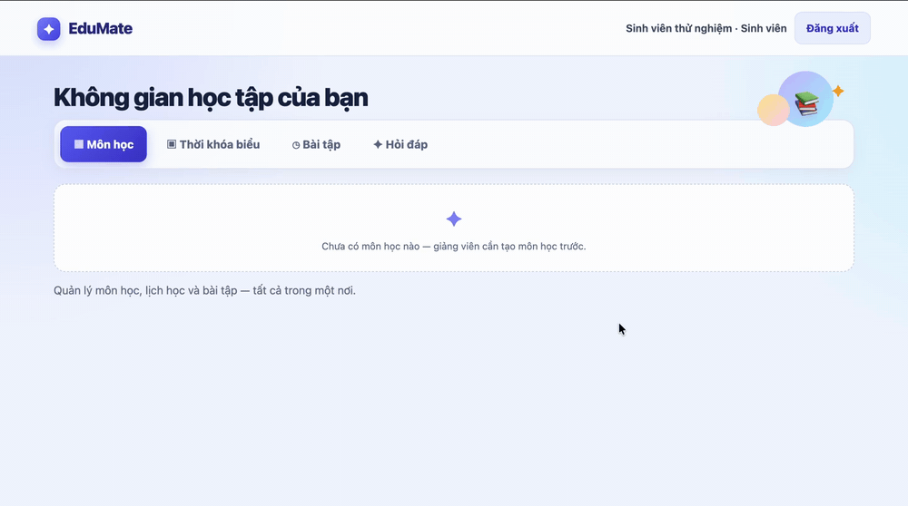

# EduMate Interface Smoke Test Report

| Field | Details |
|---|---|
| Project phase | PA2 |
| Progress reference | [Weekly 05](../../management/weekly/Week05.docx), meeting on 3 November 2026 |
| Build | `50ac2d3` |
| Test environment | EduMate running locally in Chromium |
| User roles | Student and Lecturer |

**Seven of eight scenarios passed.** The walkthrough covered sign-in, course management, the timetable, assignments, and Q&A. The remaining scenario showed an issue with the form displayed after sign-out.

## Test Results

| ID | Scenario | Expected Result | Observed Result | Status |
|---|---|---|---|---|
| UI-01 | Register and sign in as a student and as a lecturer. | EduMate opens and displays the selected role. | Both accounts entered the application and displayed the correct role. | Pass |
| UI-02 | Sign in with an incorrect password. | The sign-in page stays open and displays an error. | EduMate displayed “Incorrect email or password” and kept the user on the sign-in page. | Pass |
| UI-03 | As a lecturer, create a course and add a class session and an assignment. | The course, session, and assignment appear with the details entered. | All three appeared in the course management view. | Pass |
| UI-04 | As a student, enroll in a course and open the timetable. | The enrolled course's session appears in the timetable. | The timetable displayed the session for the enrolled course. | Pass |
| UI-05 | As a student, mark an assignment as complete. | The assignment displays a completion indicator. | The checkbox was selected and the assignment moved below incomplete items. | Pass |
| UI-06 | As a student, post a question and read the lecturer's reply. | The lecturer sees the question, and the student can read the reply. | The lecturer submitted a reply, and the student saw it in Q&A. | Pass |
| UI-07 | As a student, cancel enrollment and reopen the timetable. | Sessions for the cancelled course disappear. | The cancelled course's session disappeared, and the other course stayed visible. | Pass |
| UI-08 | Sign out immediately after creating an account. | The session ends and EduMate displays the Sign In form. | The session ended, but EduMate displayed the Sign Up form. | Fail |

## UI-08 Sign-out displays the Sign Up form

1. Open EduMate and select **Sign Up** (Đăng ký).
2. Create a test account and wait for the application to open.
3. Select **Sign Out** (Đăng xuất) immediately after entering the application.

EduMate ends the session and displays **Sign Up**. The user can select **Already have an account? Sign in** to open the Sign In form. Suggested priority is low because sign-out succeeds and the user can switch forms.

[Watch the UI-08 recording (MP4)](2026-11-11-evidence/04-ui08-logout.mp4)
