# Minh chứng kiểm thử EduMate

Các ảnh dùng dữ liệu mẫu trên EduMate cục bộ. Phần lớn là ảnh chụp màn hình EduMate. Năm ảnh QA-02, QA-03, QA-05, QA-15 và QA-16 là thẻ tóm tắt kết quả bài kiểm thử tự động. Đọc chú thích ngay phía trên mỗi ảnh để biết cần nhìn vào đâu. [Xem báo cáo kiểm thử](../README.md).

## QA-01 · Giảng viên đồng phụ trách bị trùng lịch

Lịch giảng viên B hiện hai buổi thứ Hai 08:00–09:00 và 08:30–09:30.

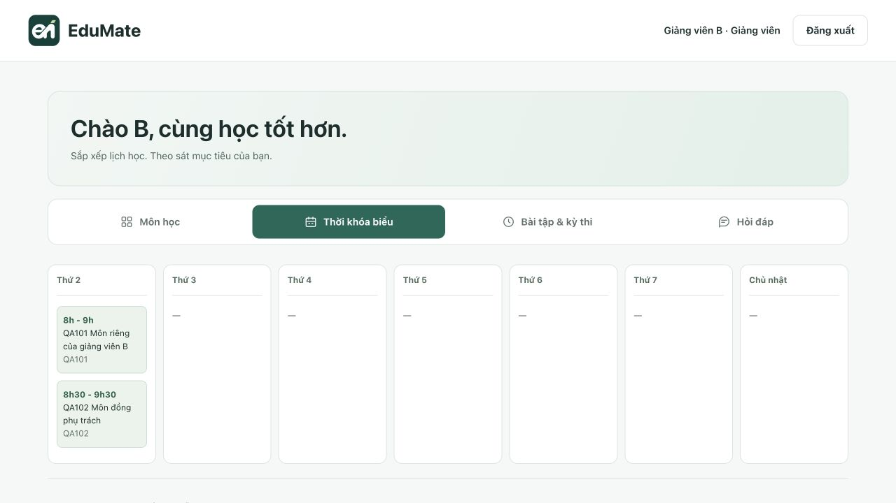

## QA-02 · API tự đổi số thập phân thành thứ Hai

Nhìn vào giá trị gửi và giá trị lưu. Bài kiểm thử gửi `0.5` cho trường ngày học. EduMate vẫn tạo buổi học và lưu `0`, tức thứ Hai.

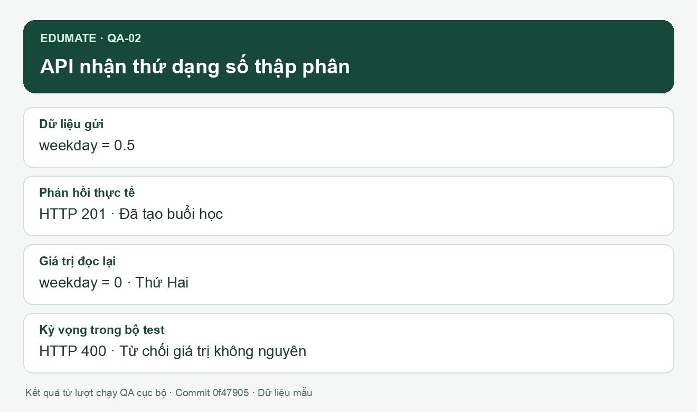

## QA-03 · Giảng viên xóa deadline thất bại, sinh viên mất dấu hoàn thành

1. **Sinh viên đánh dấu đã hoàn thành.** Trong danh sách **Bài tập** của sinh viên, deadline đang hiển thị và ô hoàn thành có dấu tick. Trên thẻ kết quả, cả hai giá trị đều là `True`, nghĩa là **Có**.
2. **Giảng viên yêu cầu xóa cùng deadline.** EduMate xóa dấu hoàn thành của sinh viên trước. Bài kiểm thử mô phỏng lỗi ở bước kế tiếp, khi hệ thống định xóa bản ghi deadline. Yêu cầu xóa trả `HTTP 500`, tức máy chủ báo thao tác thất bại.
3. **Kiểm tra lại danh sách của sinh viên.** `Deadline còn: True` nghĩa là bài vẫn hiện. `Đã tick: False` nghĩa là dấu hoàn thành đã mất dù sinh viên chưa bỏ chọn.

**Kết quả mong đợi.** Vì thao tác của giảng viên thất bại, sinh viên vẫn phải thấy deadline với dấu **Đã hoàn thành** như trước khi xóa.

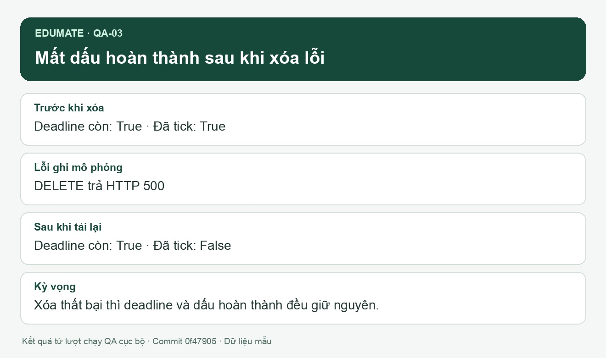

## QA-05 · Unittest đọc lẫn cấu hình Firebase thật

Đây là kết quả kiểm thử tự động trước bản sửa. Bài kiểm thử mong API trả tên miền Firebase mẫu, nhưng API trả tên miền được đặt sẵn trong môi trường thử. Hai giá trị khác nhau làm bài kiểm thử thất bại.

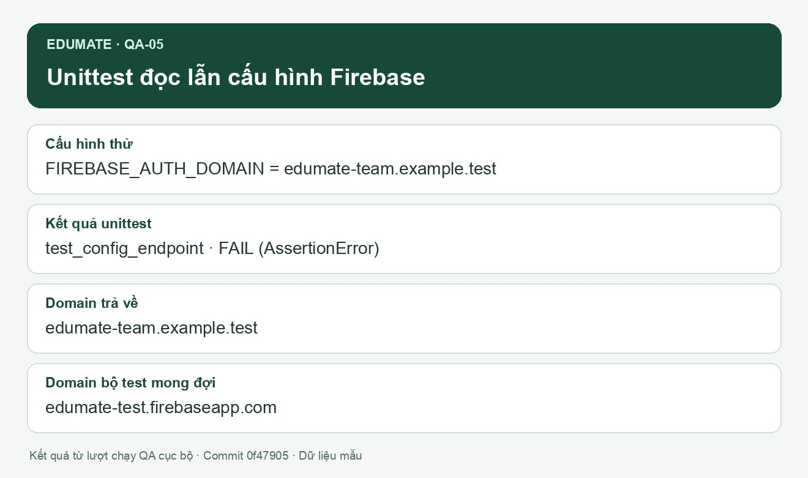

## QA-06 · Cho tạo kỳ thi với hạn đã qua

Kỳ thi vừa được tạo với hạn ngày 16/11 và xuất hiện ở danh sách sinh viên với nhãn Quá hạn.

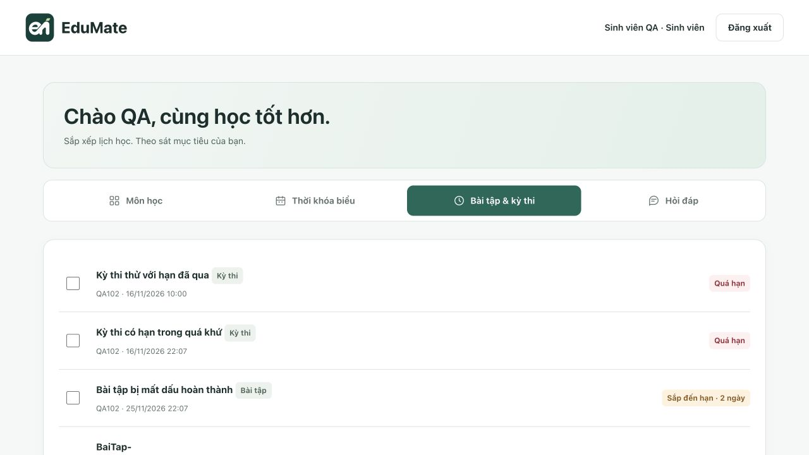

## QA-07 · Sinh viên tự phản hồi làm câu hỏi hết chờ

Màn hình giảng viên báo Đã trả lời hết, trong khi phản hồi hiển thị do sinh viên gửi.

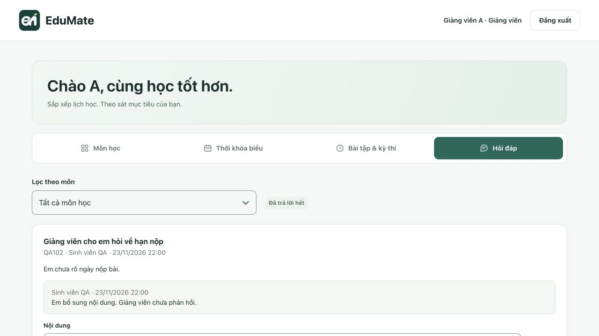

## QA-08 · Thông báo sai loại khi tạo kỳ thi

Sau khi tạo mục Kỳ thi minh chứng QA-08, thông báo thành công ở cuối màn hình ghi Đã thêm bài tập.

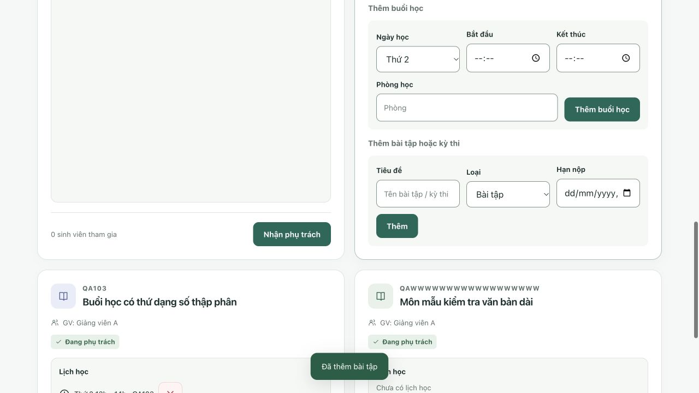

## QA-09 · Chuyển tab nhanh làm hiện sai nội dung

Tab Thời khóa biểu được tô đậm, nhưng nội dung bên dưới hiện Lọc theo môn và Đặt câu hỏi.

[Xem video QA-09 (MP4)](QA-09.mp4). Trong video, lịch hiện trước rồi vùng nội dung chuyển sang form **Đặt câu hỏi**. Nhìn vào tab **Thời khóa biểu** vẫn được tô đậm khi nội dung đổi.

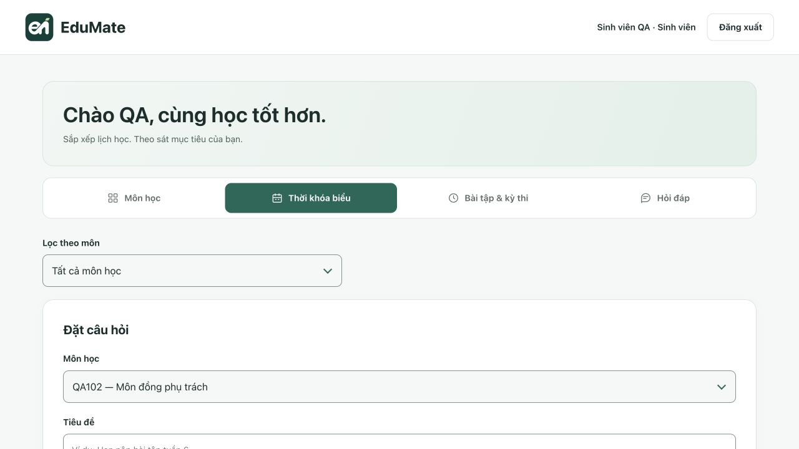

## QA-10 · Lịch sinh viên chồng nhau sau khi đã đăng ký

Sinh viên thấy hai buổi 08:00–09:00 và 08:05–08:25 sau khi giảng viên thêm lịch cho môn đã đăng ký.

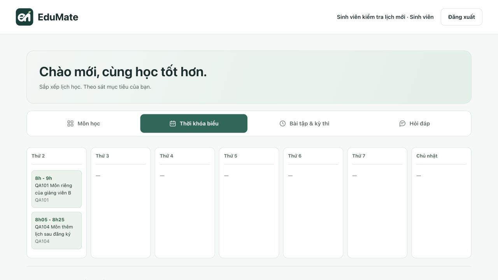

## QA-11 · Bỏ tick nhanh nhưng vẫn lưu hoàn thành

Bộ Replay mở **Bài tập & kỳ thi**, đánh dấu ô hoàn thành rồi bỏ chọn chính ô đó sau khoảng 0,15 giây. Ô trống ngay sau lần bỏ chọn. Khoảng 1,8 giây sau lần đánh dấu đầu tiên, yêu cầu lưu ban đầu mới xử lý xong và ô tự hiện lại dấu tick dù không có lần bấm thứ ba.

[Xem video QA-11 (MP4)](QA-11.mp4). Khoảng giây 12–14, nhìn vào ô bên trái **Bài tập thử đánh dấu nhanh**. Ô được tick, trở về trạng thái trống rồi tự hiện dấu tick khi con trỏ đã rời khỏi ô.

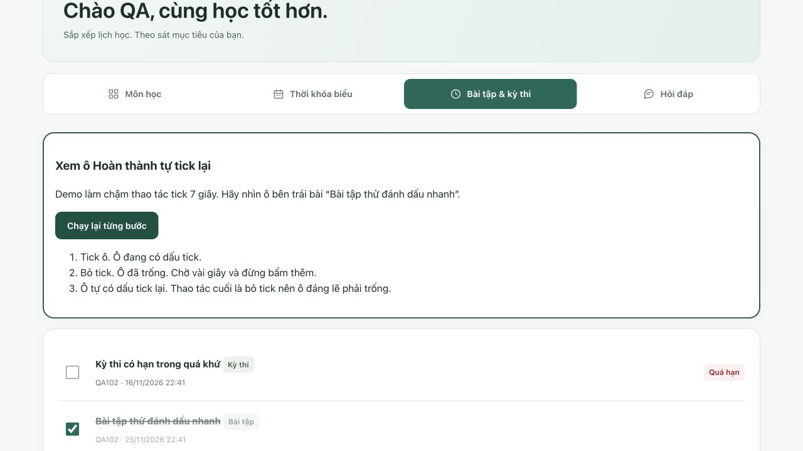

## QA-12 · Bấm đúp Đăng ký gửi hai yêu cầu

Thẻ QA105 đã đổi sang Đã đăng ký. Bên dưới là thông báo trùng từ lần bấm thứ hai.

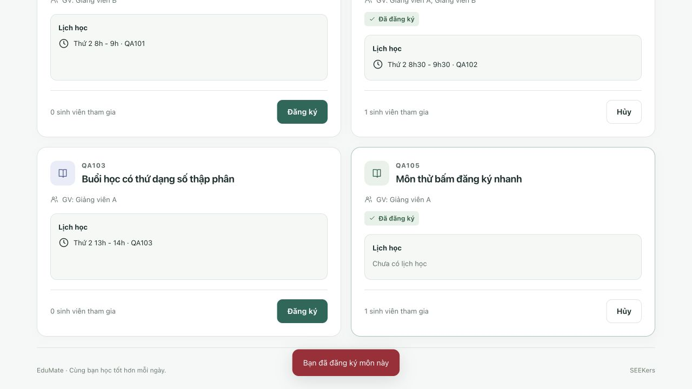

## QA-13 · Form xóa các ô sau khi báo trùng lịch

Ảnh đầu có giờ và phòng đã nhập. Sau khi bấm Thêm buổi học, form báo Trùng lịch dạy và xóa cả ba ô.

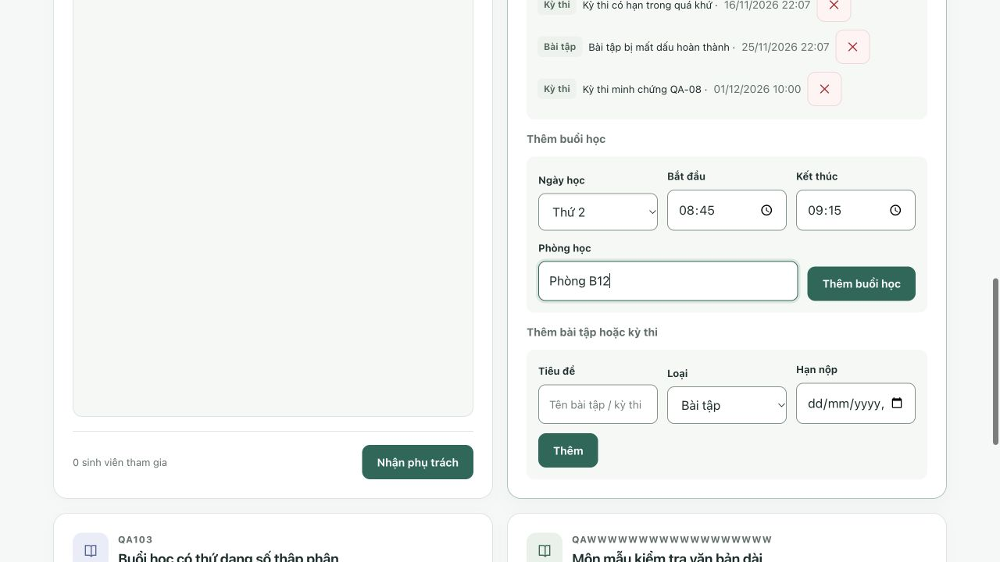

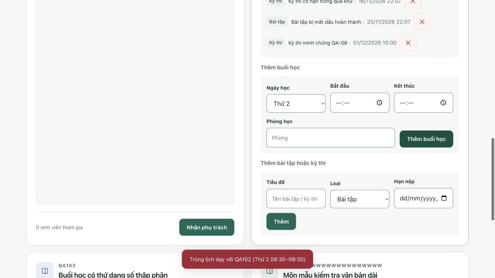

## QA-14 · Hỏi đáp bỏ sót câu chưa trả lời khi vượt 100 câu

Màn hình báo Đã trả lời hết và bắt đầu ở câu 101. Đối chiếu API trong ca này có 101 câu đã lưu, 100 câu được trả về, và câu 001 chưa được trả lời.

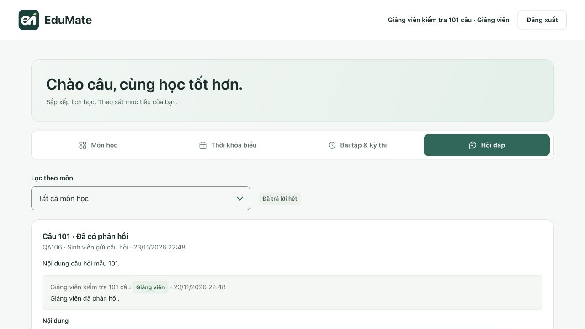

## QA-15 · Đăng ký đồng thời hai môn trùng giờ đều thành công

So sánh hai lượt thử với cùng một sinh viên. Khi đăng ký lần lượt, hệ thống từ chối môn thứ hai vì trùng giờ (`409`). Khi hai yêu cầu chạy đồng thời, cả hai đăng ký đều thành công (`201`) và lịch sinh viên có hai môn chồng giờ.

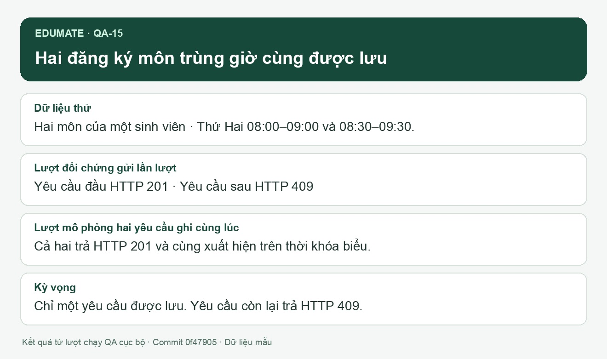

## QA-16 · Thêm đồng thời hai buổi trùng giờ đều thành công

So sánh hai lượt thử với cùng một giảng viên. Khi thêm lần lượt, hệ thống từ chối buổi thứ hai vì trùng giờ (`409`). Khi hai yêu cầu chạy đồng thời, cả hai buổi đều được lưu (`201`) dù giờ dạy chồng nhau.

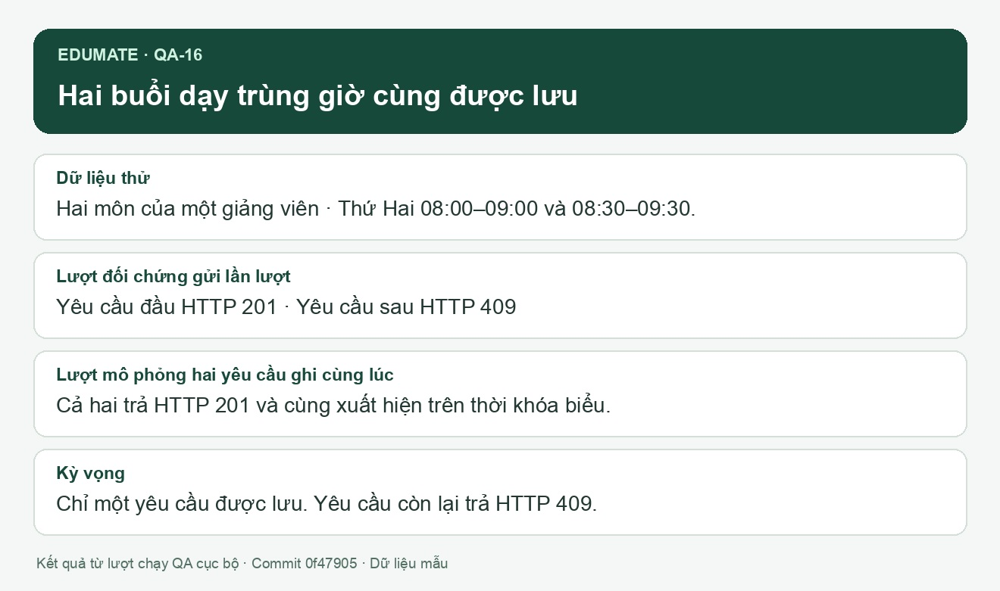

## QA-17 · Tiêu đề dài làm tràn ngang toàn trang

Tiêu đề dài bắt đầu bằng CauHoi- kéo sang phải, vượt khỏi mép thẻ câu hỏi.

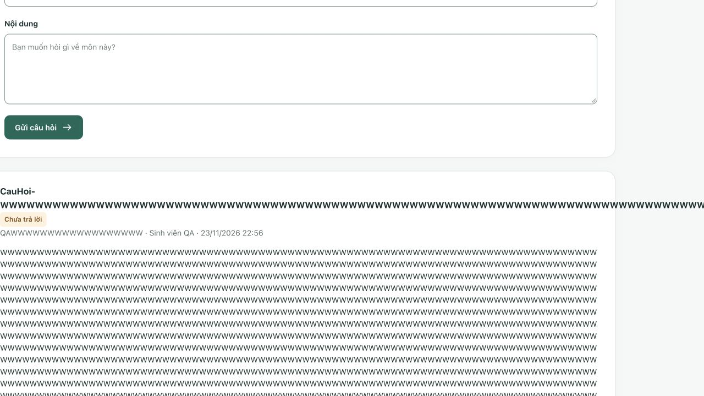
